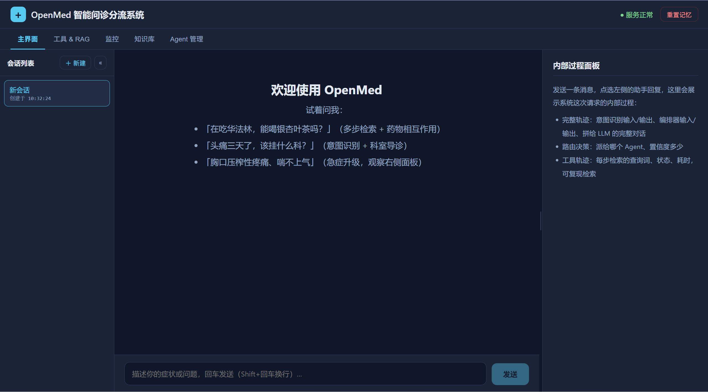

<p align="center"></p>

# OpenMed

OpenMed 是一个面向医疗问诊分流场景的多 Agent 编排智能问诊系统，覆盖症状分诊、预约挂号、用药咨询、急诊四大场景。它不是单纯的聊天机器人，而是把以下能力串成闭环：

- 三路融合的细粒度意图识别（LLM 语义理解 0.7 + Embedding 相似度 0.2 + 关键词兜底 0.1，逐级降级）
- 路由驱动的多 Agent 编排（意图 + 关键词 + 实体累积打分，支持主 Agent + 辅助 Agent 并行协作）
- 医疗 RAG 知识库：BM25 + 向量混合召回 → RRF 融合排序 → Top-K → Cross-Encoder 精排
- Redis + ChromaDB 三级记忆（工作记忆 / 情景记忆 / 用户画像，画像更新异步不阻塞回复）
- 动态 Skills 注入（按 Agent 类型和关键词匹配业务处理规范，支持运行时热重载）
- 在线监控与路由降权（Agent/工具成功率、延迟反馈到路由分数，Prometheus 指标 + 滑动窗口异常检测）
- 工具调用轨迹采集与回放（每一步检索的查询词、耗时、命中数落盘，前端 Trace 面板可视化）
- 五套离线评测考卷 + LLM-as-Judge 判分（检索、多跳、长会话、急症、意图全覆盖，382 题 / 99 题 held-out）

## 业务场景与 Agent

| 场景 | Agent | 说明 |
|------|-------|------|
| 症状分诊 | `SymptomTriageAgent` | 首诊接待、症状澄清、科室分流，不给确定性诊断结论 |
| 用药咨询 | `MedicationAgent` | 用法用量、药物相互作用、不良反应核查 |
| 预约挂号 | `AppointmentAgent` | 新预约、改期、取消、挂号费核验 |
| 急诊 | `EmergencyAgent` | 非 LLM 直接交接节点，识别到高危症状/转人工时跳过模型调用，直接标准化交接 |

意图识别覆盖 19 类细粒度意图（如 `symptom_check`、`medication_dosage`、`medication_interaction`、`appointment_reschedule`、`appointment_payment_issue`、`emergency`、`human_handoff` 等），映射到上述 4 个 Agent。复合问题（例如同时问症状和用药相互作用）会触发主 Agent + 辅助 Agent 并行处理。

## 快速开始

### 1. 准备环境

- Docker + Docker Compose（全栈一键起）
- Python 3.11 或 3.12（本地跑单测/CLI 时用；不建议 3.13+，部分依赖暂无预编译 wheel）
- `ANTHROPIC_API_KEY`（兼容 Anthropic 协议的端点即可，见下）

如果使用兼容 Anthropic 协议的第三方模型服务，配置方式：

```env
ANTHROPIC_BASE_URL=https://api.deepseek.com/anthropic
ANTHROPIC_MODEL=deepseek-v4-pro
ANTHROPIC_API_KEY=your_key
```

### 2. 配置环境变量

复制示例配置：

```bash
cp .env.example .env
```

必填的是 `ANTHROPIC_API_KEY`；使用第三方兼容端点（如 DeepSeek）时还需取消 `.env.example` 里 `ANTHROPIC_BASE_URL` / `ANTHROPIC_MODEL` 的注释（.env.example 里注释了各变量的用途）：

```env
ANTHROPIC_API_KEY=your_api_key
```

`REDIS_PASSWORD`、`CHROMA_HOST` 等其余变量均有默认值，本地快速起步无需设置。

### 3. 启动服务

推荐直接启动全栈：

```bash
docker compose up -d --build
```

查看状态：

```bash
docker compose ps
```

看日志：

```bash
docker compose logs -f openmed
```

只想在本地跑代码、用 Docker 起依赖服务方便调试时：

```bash
docker compose up -d redis chromadb
python -m venv venv && source venv/bin/activate   # Windows: venv\Scripts\activate
pip install -r requirements.txt
python -m api.main --cli
```

### 4. 访问入口

- API: `http://localhost:8000`
- Swagger: `http://localhost:8000/docs`
- Nginx 反代: `http://localhost`
- Health: `http://localhost:8000/health`
- 前端开发服务器: `http://localhost:5173`（见下方「前端」）

## 核心功能

### 对话主链路

`POST /chat`

流程是：

```text
读取记忆 -> 意图识别 -> Agent 路由 -> 执行 -> 写回记忆 -> 画像更新
```

其中「执行」是编排器内部的主 Agent + 辅助 Agent 并行协作：Skills 注入 system prompt、Agent 自主决定工具调用（知识检索等，ReAct 循环最多 3 轮）、ResponseComposer 汇总回复。检索不是独立步骤，而是 Agent 按需调用的工具。

请求示例：

```bash
curl -X POST http://localhost:8000/chat \
  -H "Content-Type: application/json" \
  -d '{"message": "布洛芬和阿莫西林能一起吃吗？", "user_id": "u1"}'
```

响应关键字段：`response` / `intent` / `intent_group` / `agent_type` / `primary_agent` / `supporting_agents` / `tools_used` / `routing_reason` / `escalated` / `knowledge_used` / `entities`。

急诊/转人工场景验证：

```bash
curl -X POST http://localhost:8000/chat \
  -H "Content-Type: application/json" \
  -d '{"message": "胸口剧烈疼痛，喘不上气", "user_id": "u1"}'
```

预期 `agent_type: "emergency"`、`escalated: true`，且不产生 LLM 调用（`EmergencyAgent` 是非 LLM 的确定性交接节点）。

### 知识库

- `POST /search` — 单独调试 BM25+向量混合召回 → RRF 融合 → Cross-Encoder 精排效果
- `POST /knowledge/add` / `POST /knowledge/upload` — 写入医疗文档。add 面向表单粘贴（JSON 批量），upload 面向现成文件（`.txt` / `.md` 整篇一篇、文件名即标题；`.json` 数组批量），单次上传上限 10MB
- `GET /knowledge/docs` — 文档列表（按标题聚合片段数，区分内置/用户上传）
- `GET /knowledge/doc/{title}` — 按标题取回一篇文档的全部片段（只读阅览）
- `GET /knowledge/stats` — 查看知识库文档统计

首次启动会自动入库内置默认知识：[data/knowledge/hospital/](data/knowledge/hospital/) 的 26 篇医院场景文档（药品手册、科室介绍、症状手册、挂号流程等）与 217 篇多跳推理语料（跨文档实体链，用于评测多步搜索）。

### Skills

- `GET /skills`
- `POST /skills/reload`
- `POST /skills/upload` — 上传新 Skill（.md/.txt/.json，表单字段 `agents` 指定适用 Agent、留空为公用；与内置 Skill 同名会被拒绝，内置不可改动）
- `GET /agents/catalog` — Agent 静态目录（角色契约、system prompt、工具白名单，前端 Agent 管理页数据源）

当前内置三类 Skills：`症状分诊接待规范`、`用药咨询处理规范`、`预约挂号处理规范`，按 `agents` + `keywords` 动态注入对应 Agent 的 system prompt。加载时不调用 LLM，纯确定性匹配（关键词子串命中 + Agent 白名单），运行时热重载即时生效。

### 监控与轨迹

- `GET /monitor` — 在线指标：各 Agent/工具的成功率、延迟、路由评分、监控惩罚
- `GET /metrics` — Prometheus 指标端点（Prometheus 容器按 `config/prometheus.yml` 每 10s 抓取）
- `GET /trace/tool/{request_id}` / `GET /trace/tools` — 工具调用轨迹（每一步检索的查询词、耗时、命中数），前端 Trace 面板的数据源
- `GET /trace/full/{request_id}` — 完整落盘轨迹（system prompt、意图识别详情、LLM 消息流、工具结果明细），前端「完整轨迹」卡片与「工具 & RAG」页的 RAG 明细数据源

### 离线评测

五套考卷位于 [data/eval/exams/](data/eval/exams/)（382 题，其中 99 题 held-out，按题目哈希划分、调参时不可见）：

| 考卷 | 考察点 | 判分方式 |
|------|--------|----------|
| qa_v1 | 单跳/多跳检索（直接打 `/search`） | MRR / hit@k + LLM-as-Judge 忠实度 |
| multihop_v1 | 跨文档多步检索（实体链） | 实体链命中 + LLM-as-Judge 忠实度 |
| long_session_v1 | 17-19 轮长会话记忆留存 | 记忆关键节点检查 + judge 复核 |
| emergency_v1 | 急症漏检/误报（红旗/阴性） | 确定性判分（读 escalated/urgency 字段） |
| intent_v1 | 意图识别 | 确定性判分 |

判分器在 [evaluation/](evaluation/)，基线跑分 CLI：

```bash
python scripts/run_baseline_eval.py          # 跑题 → 等轨迹 → 判分 → 报告
python scripts/run_baseline_eval.py --resume # 断点续跑
```

对比基准（run_id `baseline-20261013-rev3`，train 集口径，held-out 单列）：

| 指标 | 数值 |
|------|------|
| 单跳检索 MRR | 0.9245 |
| 多跳成功率 | 0.64 |
| 长会话丢失率 | 0.0833 |
| 安全违规率 | 0.0 |
| 急症漏检率 | 0.0 |

### 前端

[frontend/](frontend/) 是 Vite + React 的演示界面，顶部五个整页选项卡，每个选项卡展示系统的一个侧面：

| 选项卡 | 内容 |
|--------|------|
| 主界面 | 会话列表 + 聊天面板（走完整 `/chat` 链路）+ 右侧检查面板（意图/编排/轨迹/最终回答） |
| 工具 & RAG | 选中消息的工具调用明细：每次调用的耗时/成功/缓存/精排徽章 + RAG 链路召回排名与三种分数（融合/RRF/精排） |
| 监控 | `/monitor` 的 Agent/工具统计表 + 活动告警 + 优化建议 + Prometheus 指标原文 |
| 知识库 | 文档列表（按来源筛选，点开可只读阅览全部片段）+ 表单添加 / 文件上传入库 |
| Agent 管理 | Agent 卡片（角色契约、system prompt、工具白名单）+ Skills 列表与上传 |

使用提示：

- **主界面**：左侧会话列表可新建/切换会话（记忆按用户累积、按会话隔离）；点选任意一条助手回复，右侧检查面板展示该次请求的意图识别输入输出、Agent 路由、完整轨迹与最终回答；顶栏「重置记忆」清空演示用户 web-demo 的全部记忆（Redis + ChromaDB）
- **工具 & RAG**：展示主界面里最后点选的那条助手回复，无选中时提示先回主界面点选；工具调用的元信息来自 `/trace/tool`（内存），RAG 结果明细来自 `/trace/full`（落盘轨迹），两者按 `tool_use_id` 关联
- **知识库**：「添加文档」表单走 `POST /knowledge/add`，文件上传走 `POST /knowledge/upload`；内置文档只读，无修改/删除入口
- **Agent 管理**：上传 Skill（.md/.txt/.json）时可勾选适用 Agent（不选 = 公用）；内置 Skill 不可改动，上传同名会被后端拒绝

开发模式（Vite 代理转发到 nginx，无需处理 CORS）：

```bash
cd frontend && npm install && npm run dev   # http://localhost:5173
```

生产模式构建产物由 FastAPI 在根路径静态托管：

```bash
cd frontend && npm run build   # 产物 frontend/dist/（不进仓库）
```

## 项目结构

```text
api/                          FastAPI 入口（main.py）+ /chat 五步服务层（chat_service.py）
agents/agent_orchestrator.py  多 Agent 编排（路由打分、并行协作、ReAct、ResponseComposer）
core/                         意图识别、embedding、精排、Skill 加载、药品规则、轨迹日志、应用装配
memory/conversation_memory.py Redis + ChromaDB 三级记忆（摘要合并、情景记忆、用户画像）
mcp/tool_manager.py           工具层（缓存、熔断、限流、精排调用）
mcp/knowledge_base.py         BM25 + 向量混合检索知识库（别名扩展、分块、RRF）
monitor/performance_monitor.py 在线监控（Prometheus 指标、滑动窗口异常检测、路由降权）
evaluation/                   考卷加载 + 判分器（LLM-as-Judge、确定性判分）+ 基线跑分
scripts/                      数据/评测流水线（考卷生成与校验、基线评测、知识库入库等）
frontend/                     Vite + React 前端（主界面 / 工具&RAG / 监控 / 知识库 / Agent 管理五个页面）
data/eval/                    五套评测考卷 + 判分规则
data/knowledge/               内置默认知识（医院文档 + 多跳语料 + 别名表）
config/                       Prometheus / Nginx 配置
skills/                       动态业务规则（SKILL.md 等，运行时热重载）
tests/                        pytest 单元测试（373 个，不联网）
```

## 运行时架构

```text
用户请求
  -> /chat（api/chat_service.py 五步服务层）
  -> MemoryManager 读取工作记忆、情景记忆、用户画像，打包为上下文
  -> IntentRecognizer 三路融合输出 intent / intent_group / urgency / entities
  -> AgentOrchestrator 路由到 SymptomTriage / Medication / Appointment / Emergency
  -> Agent 自主决定工具调用（search_knowledge_base 等，ReAct 最多 3 轮）
  -> ResponseComposer 汇总主/辅助 Agent 回复
  -> 写回 Redis 和 ChromaDB，异步更新用户画像
  -> Monitor 采集在线指标；TrajectoryLogger 落盘工具调用轨迹
```

## 主要端口

| 服务 | 端口 |
|---|---:|
| OpenMed API | 8000 |
| ChromaDB | 8001 |
| Redis | 6379 |
| Prometheus | 9090 |
| Nginx | 80 |

## 测试

单元测试（373 个，不依赖 Docker/API Key/网络，mock LLM client）：

```bash
python -m pytest -q
# Windows（uv 创建的 venv）: .venv\Scripts\python.exe -m pytest -q
```

覆盖 Agent Profile 契约、路由决策（单 Agent / 主辅并行）、工具白名单隔离、工具调用往返、急诊非 LLM 交接节点、三级记忆、意图识别降级链、考卷加载校验、判分器边界等场景。

想验证真实端到端链路（`/chat` + Redis + ChromaDB + 真实模型调用），需要先 `docker compose up -d --build` 并配置好 `ANTHROPIC_API_KEY`，再通过 Swagger UI 或 curl 调用。

## 开发和调试

常用顺序：

```text
1. /health
2. /chat
3. /skills
4. /monitor
5. /trace/tools
```

致谢：claude，小熊饼干
